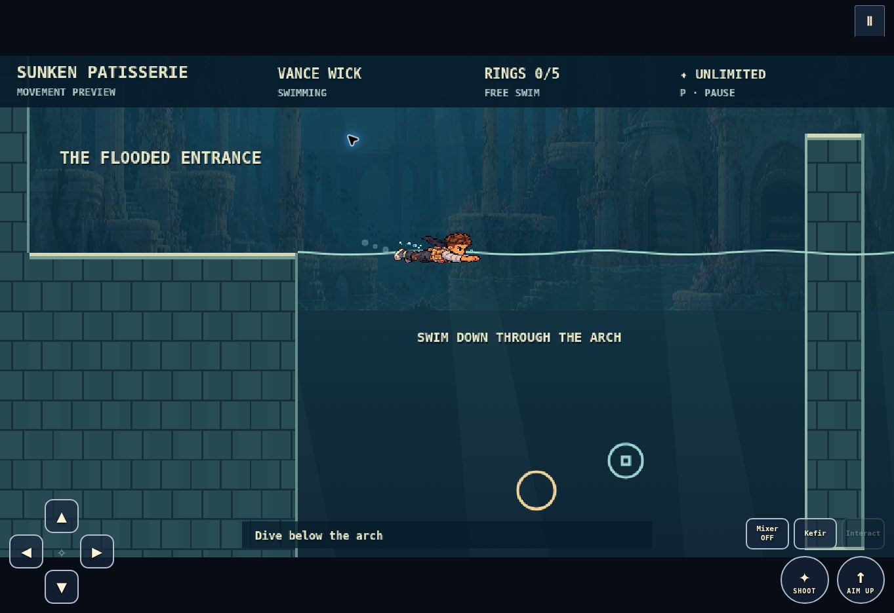

# Sunken Patisserie — isolated movement preview

Milestone 2: Joel selected free swimming after playing the comparison prototype. This is a short practice course, not World 4 campaign integration.

Movement decision, October 22, 2026: “Free swim feels a little less natural but easier so let's go with that.” Keep the current responsive free-swim tuning. Naturalness remains feedback for animation and later presentation polish, not permission to replace the approved control model. The comparison selector has been removed.

## Try it

Serve the repository root over HTTP and open `previews/sunken/index.html`. Use the branch preview link supplied with the review commit for hosted play. Select Loafy or Vance Wick in the pause menu. Touch controls and fullscreen use the existing shell.

- **Arrows / WASD:** swim freely in water. On land, Up/W jumps.
- **Space:** jump on land; hold with Shoot to aim upward in water.
- **X / K:** shoot. Swimming upward alone does not aim upward.
- **Touch:** slide around the four-direction pad, including diagonals. Hold Aim Up + Shoot for upward fire.
- **C / Mixer:** toggles the mixer presentation. Required underwater mixer combat is deferred.
- **V / Kefir:** stored swim-speed boost; three charges per attempt.
- **P / Escape:** pause, choose a hero, return to checkpoint, restart or enter fullscreen.

The preview uses the approved free-swimming model. No oxygen limit or combat pressure. The historical buoyant reference remains in the testable helper for comparison coverage, but is not offered in the player interface.

## Course

Walk right off the dry landing. Swim down through the tall wall's submerged arch. Cross the lower gallery against the gentle current, then enter the bubble shaft from its lower inlet. Rise to the shaft's open top, swim right, and breach the surface beside the exit ledge. The far flag confirms completion. Rings and shooting targets are optional practice aids.

The lower gallery activates an underwater checkpoint. Recovering there restores the horizontal body without resetting the route. Pause → Restart mission returns to the entrance.

## Implementation boundaries

`build.cjs` derives the preview HTML from the current production entry point, adds a base path and preview-only scripts/styles, and installs the adapter before shell binding. Rebuild with `node previews/sunken/build.cjs` when the production shell changes. All production modules are loaded directly from `keen/`; campaign files are not copied or modified.

`swim-physics.js` contains the independently testable region/resize, swept movement, current, direction-pad and projectile-origin helpers. `prototype.js` adapts the production update/render lifecycle only inside this page. Dry physics, fixed-step timing, character selection, fullscreen and pause ownership come from the shipped modules.

The underwater collision body is a fixed 58×26 rectangle for both heroes; the original dry body is 29×38. Resizing preserves the torso centre and requires clear geometry. Water boundaries use hysteresis. An aim/stroke held across exit cannot become a stored land jump. Currents are bounded and counter-steerable even beside a wall.

Hero presentation uses temporary runtime crops of the approved horizontal concept sheet, keyed as a canvas sprite material; original art files are untouched. These are pose samples with a simple two-pose stroke cycle, **not final animation atlases**. Upward firing uses a temporary weapon overlay. Production-quality stroke, turn, entry/exit, hurt and shooting atlases remain a later art task.

The environment is an intentionally simple collision course with a subdued concept backdrop. The existing Fungal Caverns music is a temporary audition bed; no new World 4 score is integrated. Mixer combat, aquatic enemies, boss, valves and campaign progression are deferred. Recipe/best-score writes are disabled in the preview; character and control preferences retain the existing shell behavior.

## Validation

Run `node --test keen/tests/*.test.cjs previews/audio/audio.test.cjs` from the repository root. The new tests cover movement tuning, diagonals, blocked transitions, current escape, aiming/muzzle paths, keyboard/touch ownership, checkpoint restore and complete course traversal by both heroes. Existing dry-world baselines remain intact.

Latest result: **432 passed, 0 failed**, including 16 new swimming tests.

Browser review checks startup loading, both horizontal hero poses and touch-pad presentation. Physical phone multitouch and subjective movement feel still require Joel/Vance playtesting. No merge to main has been performed.
